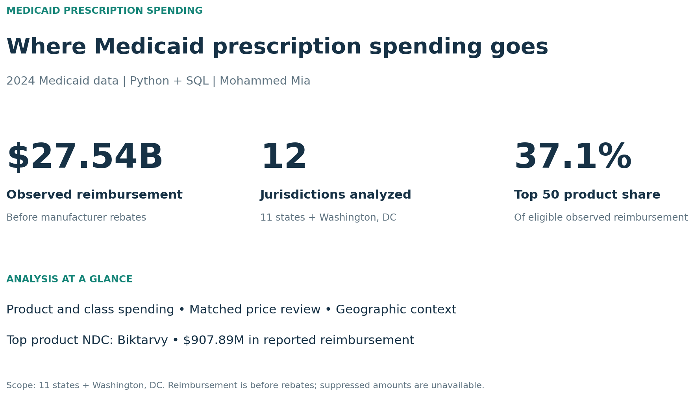
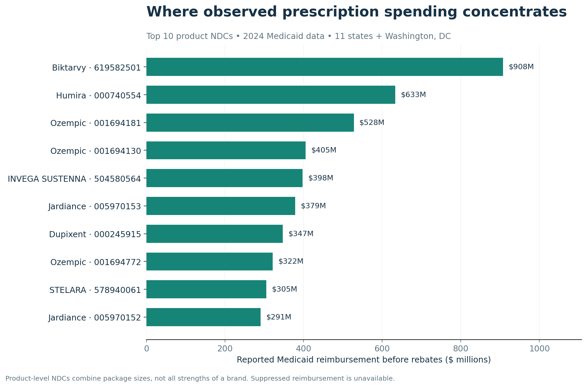
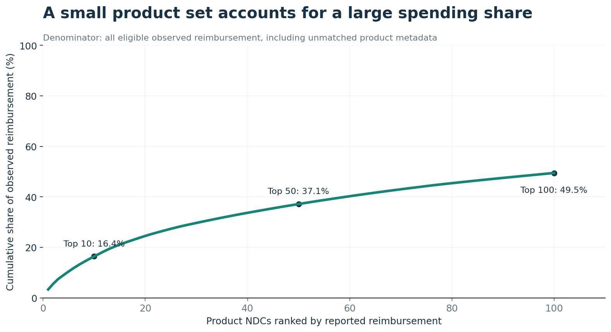
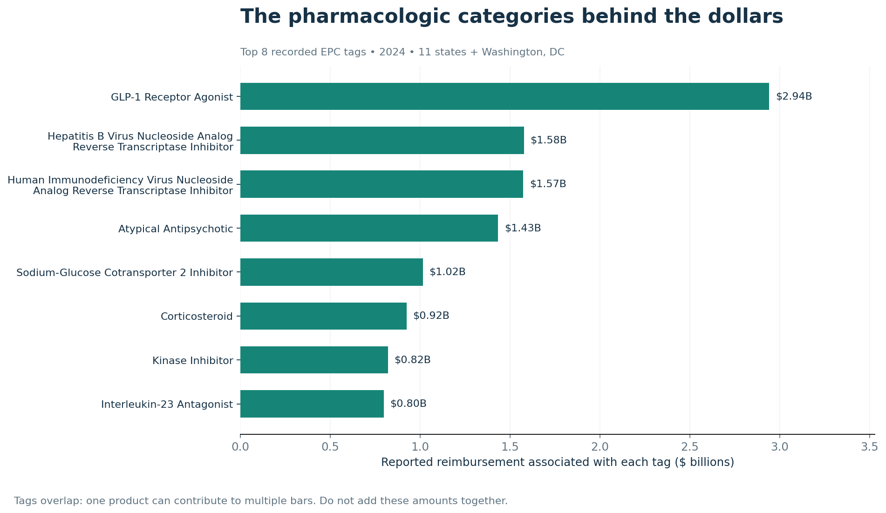
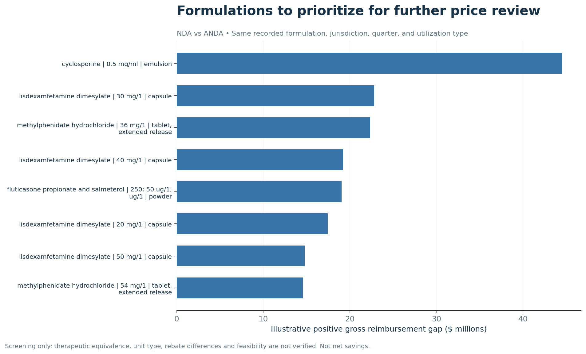
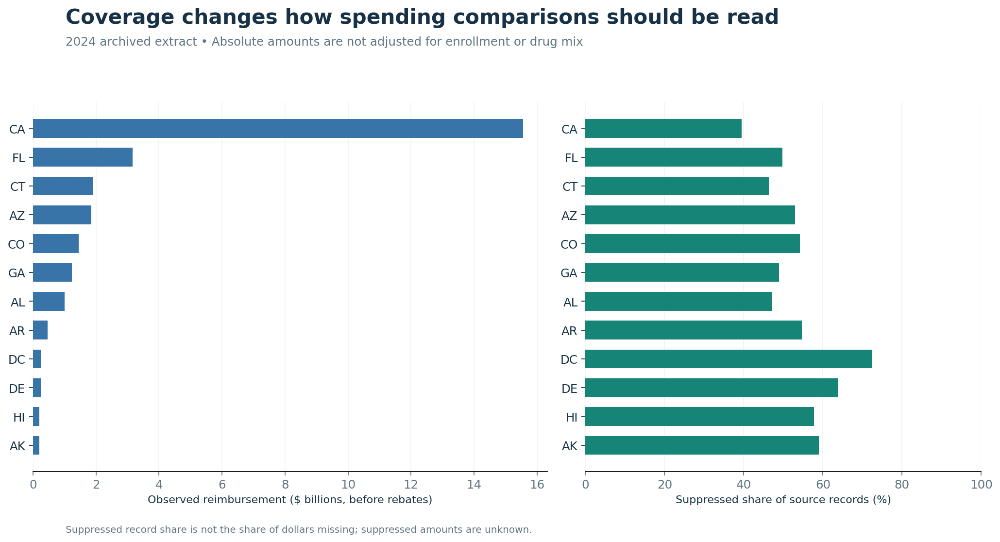
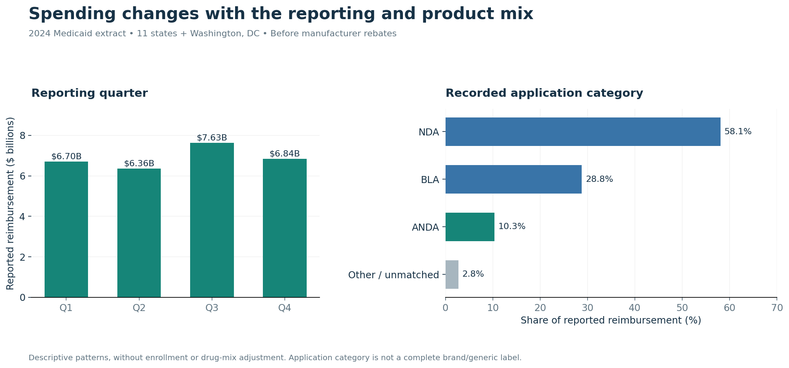

# Medicaid Prescription Spending Analysis

**Mohammed Mia · Healthcare Data Analytics · Python + SQL**

[](https://github.com/mohammedmia1/medicaid-spending-analytics/actions/workflows/validate.yml)

**[Follow the analysis notebook](notebooks/Medicaid_Spending_Analysis.ipynb)** · **[Read the executive brief](reports/EXECUTIVE_BRIEF.pdf)** · **[Explore the results](reports/README.md)**



## Why I built this project

Prescription spending raises two different questions: **where are the dollars going, and where might a closer price review be worthwhile?** An expensive medication can account for substantial spending because of its price, its utilization, or both. A lower-priced product may also exist without being an appropriate substitute for every patient.

I built this project to move from a broad spending picture to a focused set of products for investigation. I combined Medicaid utilization records with FDA product information, used SQL to identify spending concentration, and compared reimbursement per unit for products with matching recorded formulations. My goal was to produce an analysis that a healthcare finance analyst could follow from the source data to a review priority.

The included 2024 extract covers **11 states and Washington, DC**, with **$27.54 billion in reported reimbursement before manufacturer rebates**. Every finding below refers to this extract.

## The five questions that guide the analysis

| Question | How I answer it |
|---|---|
| **Q1. Which drugs account for the most spending?** | Rank product NDCs and calculate their individual and cumulative spending shares. |
| **Q2. Which drug classes account for substantial spending?** | Summarize the directory's established pharmacologic class (EPC) tags, keeping overlapping tags visible. |
| **Q3. Where could lower-priced alternatives merit a savings review?** | Compare unit-weighted reimbursement within matched NDA/ANDA reporting groups and rank positive gross differences. |
| **Q4. Which products have potentially comparable alternatives?** | Require matching ingredient, strength, dosage form, and route; identify what still needs clinical and unit-level verification. |
| **Q5. How do geography, reporting period, and product category relate to spending?** | Describe jurisdiction totals, suppression, quarterly changes, and application-category shares. |

I approach these questions in sequence: establish where spending concentrates, understand the product categories involved, examine price differences, and then interpret the results in their reporting context. Q4 identifies recorded matches rather than confirming therapeutic equivalence. Q5 describes patterns rather than estimating causal cost drivers.

## From source records to an analytical dataset

The utilization file tells me how much was reimbursed and how many units were reported. The product directory adds the ingredient, strength, dosage form, route, and application category needed to interpret those amounts.

| Source | Records | Contribution |
|---|---:|---|
| Medicaid utilization extract | 1,048,575 | Jurisdiction, quarter, package NDC, utilization, reimbursement, and suppression |
| FDA product directory extract | 113,878 | Product descriptions, pharmacologic tags, application categories, and marketing dates |

Before comparing prices, I had to resolve three practical issues. First, NDCs have different formats across the two sources. I preserved leading zeros and standardized the labeler/product segments to a nine-character product key. Second, a directory key can appear more than once. I collapsed identical analytical descriptions and left conflicting keys unmatched so they could not multiply reimbursement. Third, suppressed amounts are unknown. I kept them missing and retained their records in coverage reporting.

This produced **504,630 records with reported reimbursement** and **543,945 records with suppressed amounts**. My left join preserved the utilization record count and spending total. Unambiguous product information covers **99.42% of reported dollars**, while unmatched spending remains in the overall denominator.

The [data guide](data/README.md) describes the fields and coverage. The [methodology](docs/METHODOLOGY.md) explains each preparation decision and calculation.

## Q1. I started with the products behind the spending

I aggregated reimbursement by product NDC, ranked the totals, and used SQL window functions to calculate spending shares. This distinguishes a product's dollar contribution from its price per unit: a high unit price alone does not tell me how much it contributes to the budget.



**Biktarvy product NDC 619582501 leads the ranking at $907.89M.** The top 10 product NDCs account for **16.4%** of reported reimbursement, and the top 50 account for **37.1%**.



My takeaway is a practical review sequence: begin with the products that account for a large share of dollars, then investigate their utilization and prices. A product NDC combines package sizes; different strengths of the same brand can remain separate. I therefore interpret this as a product-level ranking, rather than a ranking of all spending under each brand name.

## Q2. I then looked at the pharmacologic categories

Product rankings identify individual review targets. Pharmacologic tags help me see the broader categories represented among those dollars. I used the FDA directory's recorded EPC tags and counted each distinct tag once per utilization record.



Products carrying the **GLP-1 Receptor Agonist** tag account for **$2.94B** in reported reimbursement. Other prominent tags include HIV-related reverse transcriptase inhibitors, atypical antipsychotics, and SGLT2 inhibitors.

These categories give context to the product-level findings, but a combination drug can carry several tags. **I do not add tag totals together or present them as slices of a mutually exclusive budget.** Another $5.19B has no recorded EPC tag or unmatched metadata; those dollars remain in overall spending.

## Q3. I translated observed price differences into review priorities

The next question was whether products with similar recorded formulations had materially different reimbursement per unit. I required the same ingredient, strength and strength unit, dosage form, and route. I also matched jurisdiction, quarter, and managed-care or fee-for-service utilization type, and checked marketing-date overlap.

Within each matched reporting group, I used the directory's **NDA and ANDA application categories** to form the comparison. These categories help organize the analysis, but they are not a complete brand/generic classification.

I calculated the price on each side as:

```text
Unit-weighted reimbursement = total reimbursement ÷ total units
Signed gross gap = (NDA unit price − ANDA unit price) × NDA units
Positive gross gap = max(signed gross gap, 0)
```

I chose this weighting because the question concerns observed dollars at observed utilization. A small record with an unusual price should not receive the same influence as a record representing many units. The comparison uses observed prices directly; it does not require predicting an unobserved price.



I identified **562 recorded formulations across 6,675 matched reporting groups**. Positive differences sum to **$516.16M**; retaining negative differences produces a **$506.73M signed aggregate**. Reporting both makes the direction of the comparisons visible.

| Example formulation | Positive gross gap |
|---|---:|
| Cyclosporine, ophthalmic emulsion, 0.5 mg/mL | $44.50M |
| Lisdexamfetamine dimesylate, oral capsule, 30 mg | $22.83M |
| Methylphenidate hydrochloride, oral extended-release tablet, 36 mg | $22.34M |

**I interpret these amounts as a price-review screen.** They identify where observed differences deserve investigation. They do not establish achievable savings: reimbursement unit types, manufacturer rebates, availability, and clinical substitution requirements still need verification.

## Q4. I separated a recorded match from a usable alternative

A shared ingredient name is only the beginning of an alternative-product review. Strength, route, and release form matter, which is why I retained those descriptors in the matching rules.

For example, the cyclosporine result refers specifically to **0.5 mg/mL ophthalmic emulsion**. It is not a recommendation to substitute any product containing cyclosporine. Even an exact recorded formulation match does not establish therapeutic equivalence, identical reimbursement units, or suitability for a particular patient.

My output for this question is a [formulation-level review list](reports/tables/formulation_gap_ranking.csv), supported by [reporting-group detail](reports/tables/formulation_strata_gaps.csv.gz). Before treating a candidate as actionable, I would verify the unit basis, applicable therapeutic-equivalence evidence, practical availability, and net rebate economics.

## Q5. I put the findings in geographic and reporting context

I compared jurisdiction totals alongside the share of records with suppressed amounts. **California accounts for 56.5% of observed reimbursement**, but that does not establish higher prices or lower efficiency. Enrollment, utilization, drug mix, and reporting completeness can all affect absolute spending.



I also examined quarterly totals and application categories. Q3 has the highest reported reimbursement at **$7.63B**. NDA-listed products account for **58.1%** of spending, BLA-listed products for **28.8%**, and ANDA-listed products for **10.3%**.



These patterns describe where and when spending appears in the extract. I do not treat them as evidence that geography or an application category causes a particular price. Suppression affects what is observable, and its record share does not reveal the amount of dollars missing.

## What I would do with the results

I would begin a spending review with the concentrated high-dollar product set, use the pharmacologic tags to organize that review, and investigate the matched formulation gaps where the dollar exposure is substantial. I would validate comparability and net economics before considering any intervention.

The central finding is that **a focused product review is a useful starting point**. The project provides the rankings, matching rules, and reporting context needed to choose that starting point responsibly.

## Tools and reproducibility

I used **Python and pandas** for preparation and matching, **SQLite and SQL** for spending analysis, **matplotlib** for the visualizations, and **GitHub Actions** for automated validation. The repository includes source CSVs, executed notebook outputs, SQL queries, and generated result tables.

Requires Python 3.11 or newer; no credentials or database server are needed.

```bash
pip install -r requirements.txt
pip install -e . --no-deps

python -m medicaid_analytics.pipeline
python -m unittest discover -s tests -v
python -m medicaid_analytics.verify
python scripts/build_notebook.py
```

The pipeline produces a local SQLite database, [result tables](reports/tables/), seven figures, and an [analysis summary](reports/analysis_summary.json). Allow about 500 MB of free disk space and at least 2 GB of available memory. To regenerate the PDF separately, install `reportlab` and run `python scripts/build_brief.py`.

| Explore | Contents |
|---|---|
| [Analysis notebook](notebooks/Medicaid_Spending_Analysis.ipynb) | Executed code, visualizations, and interpretation across the five questions |
| [Methodology](docs/METHODOLOGY.md) | Eligibility, joins, weighting, matching, and analytical boundaries |
| [Data guide](data/README.md) | Source files, fields, and coverage |
| [Results guide](reports/README.md) | Tables and figures organized by question |
| [SQL](sql/) | Product, jurisdiction, quarterly, and application-category queries |

## Scope and sources

The extract covers 11 states and DC and reaches the source worksheet's row limit; complete national or within-jurisdiction coverage is not established. Suppressed dollars are unknown. The directory is not a historical 2024 snapshot, its application categories do not fully define brand/generic status, and its descriptors do not certify therapeutic equivalence. Reported reimbursement is before manufacturer rebates.

Sources: [CMS 2024 State Drug Utilization Data](https://data.medicaid.gov/dataset/61729e5a-7aa8-448c-8903-ba3e0cd0ea3c), [FDA NDC Directory](https://www.fda.gov/drugs/drug-approvals-and-databases/national-drug-code-directory), and [CMS reporting definitions](https://www.medicaid.gov/medicaid/prescription-drugs/state-drug-utilization-data/state-drug-utilization-data-faq).

Academic collaborators: Annie Qin, Marcello Borromeo, Dhruv Nair, and Mo Mia (Mohammed Mia), ASU CIS 450.
